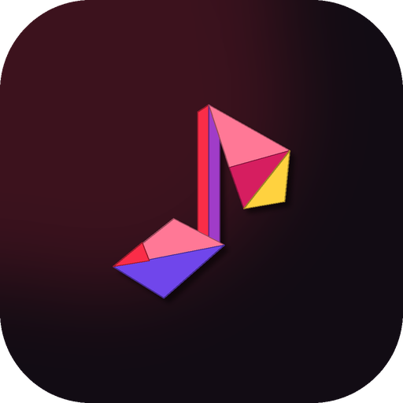
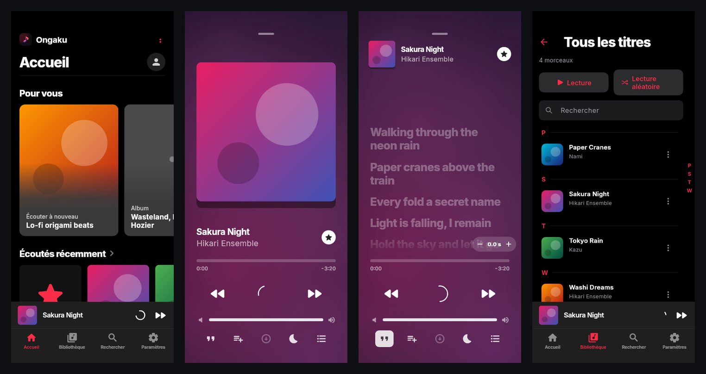
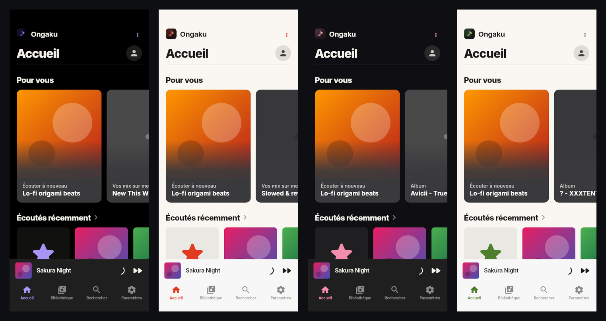
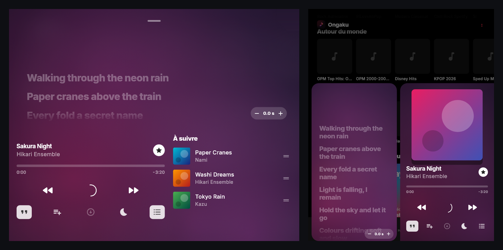

  

<h1 align="center">Ongaku</h1>

<b>Écoute. Respire.</b> par ORIKAMI

  <a href="https://github.com/orikami-dev/ongaku/releases/latest">⬇️ <b>Télécharger la dernière version</b></a>
  ·
  <a href="https://github.com/orikami-dev/ongaku/releases">📦 Toutes les versions</a>
  ·
  <a href="CHANGELOG.md">📝 Journal des versions</a>

---

## 🎵 Le projet

Ongaku est un lecteur de musique Android gratuit et sans publicité, au style Apple Music. Il reprend tout ce que fait [Musify](https://github.com/gokadzev/Musify) (recherche, streaming, playlists, paroles, radios, téléchargements) et lui donne une interface pensée pour le téléphone et les pliants.

  

| | |
|---|---|
| 🏠 **Pour vous** | Accueil façon Apple Music, avec tes playlists, tes écoutes récentes et des sélections. |
| 🎧 **Lecteur** | Plein écran animé, fond aux couleurs de la pochette, paroles synchronisées dans leur propre zone. |
| 📁 **Fichiers locaux** | La musique déjà présente sur le téléphone, à côté du streaming. |
| 🔊 **Son calibré** | Un réglage par sortie (haut-parleur, écouteurs, voiture), avec test acoustique ou test d'audition. |
| 🌙 **Mode doux** | Fondu enchaîné entre les titres. |
| 🚗 **Android Auto** | Tes onglets et ta musique en voiture. |
| 🔄 **Mises à jour intégrées** | Les nouvelles versions sont proposées directement dans l'app. |

## 🎨 Quatre thèmes

Chaque thème a ses couleurs et son icône d'app assortie.

| Thème | En une phrase |
|---|---|
| 🖋️ **Sumi** | L'encre de Chine, sombre, avec une touche violette. |
| 📜 **Washi** | Le papier japonais, clair et chaleureux. |
| 🌸 **Sakura** | La nuit rose des cerisiers en fleurs. |
| 🍵 **Matcha** | Le vert tendre du thé, en clair. |

  

## ✨ Points forts

- 📐 Interface à la taille de chaque écran : téléphones, pliants, tablettes.
- 📖 Sur un pliant à moitié ouvert, le lecteur se partage : pochette ou paroles en haut, commandes et file d'attente en bas.
- 🔤 « Tous les titres » avec index alphabétique.
- 📥 Import de playlists Spotify, Deezer et Apple Music, avec nom, pochette et tous les titres.
- 📊 Replay : tes statistiques d'écoute.
- 🚫 Sans publicité, sans abonnement, SponsorBlock intégré.

  

## ⭐ Mises à jour majeures

| Version | Ce qu'elle a apporté |
|---|---|
| [1.0](https://github.com/orikami-dev/ongaku/releases/tag/v1.0) | Première version publique : lecteur partagé sur les pliants, interface à la taille de l'écran, Android Auto, mises à jour intégrées. |

## 🛠️ Le dépôt

| Dossier | Contenu |
|---|---|
| `lib/ongaku/` | Tout le code propre à Ongaku (interface, lecteur, son, thèmes, fichiers locaux) |
| `lib/` (reste) | Le code de Musify, gardé tel quel pour suivre ses mises à jour |
| `packages/` | Paquets embarqués (lecture audio, extraction) |
| `docs/` | Notes de chaque version (`docs/releases`), images |
| `scripts/` | Synchronisation avec Musify, vérifications |

Construire : `flutter build apk --flavor github --release --target-platform android-arm64`. Les points de contact avec Musify sont listés dans [ONGAKU.md](ONGAKU.md).

## ⚖️ Licences

Ongaku est une version modifiée de [Musify](https://github.com/gokadzev/Musify) de Valeri Gokadze et ses contributeurs, distribuée comme lui sous licence GNU GPL v3.0 (voir [LICENSE](LICENSE) et [NOTICE.md](NOTICE.md)). Pour soutenir Musify : [ko-fi.com/gokadzev](https://ko-fi.com/gokadzev). Ongaku n'est affilié ni à Apple, ni à YouTube, ni à Google, ni à Spotify, ni à Deezer.
